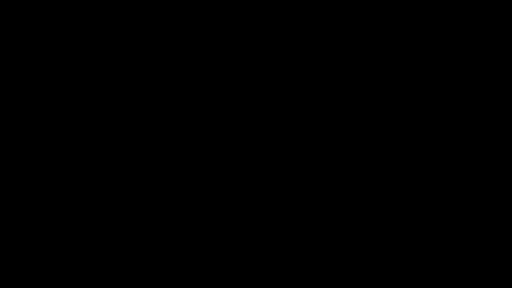

# Kinh Phật Video

Dự án tạo video kể chuyện kinh Phật bằng **Remotion** (React + TypeScript).
Video 16:9, có hình ảnh, chuyển động, lời đọc kinh.

## Video thử nghiệm: Viên sắt nóng



- File MP4 đầy đủ: [`renders/vien-sat-nong.mp4`](renders/vien-sat-nong.mp4) — 5 giây, 1920×1080, 30fps.
- Nội dung: một chúng sanh khổng lồ có viên sắt nóng ở ngực. Viên sắt **bay ra khỏi ngực**
  theo đường vòng cung về phía trước, lơ lửng, rồi **bị hút trở lại** và đâm vào ngực
  (máy quay rung, tia lửa bùng ra, vết bỏng lóe sáng).
- Lửa, quầng sáng, vệt chuyển động, tia lửa và ánh sáng chiếu lên thân đều bám theo vị trí viên sắt.

Hình chúng sanh hiện là **hình minh họa tạm bằng các lớp đồ họa vector** để kiểm tra chuyển động.
Sau này có thể thay bằng tranh vẽ thật mà giữ nguyên hiệu ứng.

## Cấu trúc code

| File | Vai trò |
| --- | --- |
| `src/Root.tsx` | Đăng ký video `VienSatNong` (150 khung, 30fps, 1920×1080) |
| `src/scenes/HotIronBall/ballMotion.ts` | **Quỹ đạo viên sắt** – sửa các mốc thời gian / vị trí tại đây |
| `src/scenes/HotIronBall/Giant.tsx` | Chúng sanh khổng lồ, vết bỏng, ánh sáng chiếu lên thân |
| `src/scenes/HotIronBall/IronBall.tsx` | Viên sắt, lưỡi lửa, quầng sáng, vệt chuyển động |
| `src/scenes/HotIronBall/Sparks.tsx` | Tia lửa (có trọng lực) và đợt bùng nổ khi va chạm |
| `src/scenes/HotIronBall/Background.tsx` | Bầu trời, núi, tàn lửa bay |
| `.agents/skills/` | Remotion Agent Skills chính thức (hướng dẫn cho AI) |

## Cách chạy trên máy của bạn

Cần cài [Node.js](https://nodejs.org) (bản 22 trở lên). Mở Terminal trong thư mục dự án:

```bash
npm install
```

Mở trình xem trước (Remotion Studio) trên trình duyệt, có thể tua từng khung hình:

```bash
npm run dev
```

Xuất video MP4 (file ra nằm ở `out/vien-sat-nong.mp4`):

```bash
npm run render
```

Kiểm tra lỗi code:

```bash
npm run lint
```

> Lưu ý: lần render đầu tiên Remotion sẽ tự tải một trình duyệt Chrome thu gọn (cần Internet).
